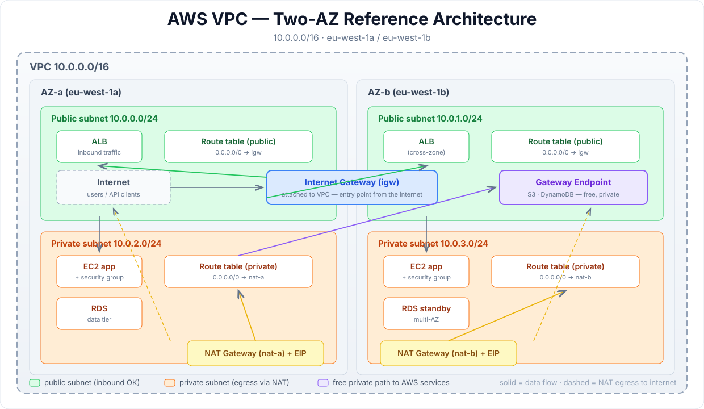

# AWS VPC Networking Guide

[](https://aws.amazon.com/vpc/)
[](LICENSE)
[](.)

> **TL;DR** — A VPC is your private datacenter inside AWS. This guide shows you how to carve it into public and private subnets, route traffic through Internet and NAT gateways, and lock it down with two layers of firewalls — security groups and network ACLs. Clone the ideas, not the YAML: the subnet planner in `subnet_planner.py` will slice any CIDR for you.

---

## Architecture



A two-AZ design: public subnets host the load balancer (via an Internet Gateway), private subnets host app servers and databases (egress via NAT Gateways), and Gateway Endpoints reach S3/DynamoDB without touching the internet.

## The 30-second mental model

| Concept | One-liner |
|---|---|
| **VPC** | An isolated virtual network with its own IP range (`10.0.0.0/16`) |
| **Subnet** | A slice of the VPC bound to one AZ (public = route to IGW, private = not) |
| **Route table** | The GPS: destination CIDR → target (IGW, NAT GW, endpoint…) |
| **Internet Gateway** | The front door for *inbound* traffic to public subnets |
| **NAT Gateway** | The back door: private subnets *initiate* outbound, nobody reaches in |
| **Security group** | Stateful firewall on the instance/ENI — allow rules only |
| **Network ACL** | Stateless firewall on the subnet — allow *and* deny rules, numbered |
| **VPC Endpoint** | Private tunnel to AWS services (S3, DynamoDB) — no NAT charges |

## Security groups vs Network ACLs

| | Security Group | Network ACL |
|---|---|---|
| Level | Instance / ENI | Subnet |
| Stateful? | ✅ Yes — return traffic auto-allowed | ❌ No — you must allow both directions |
| Rules | Allow only | Allow **and** deny |
| Evaluation | All rules evaluated | Numbered order, first match wins |
| Default | Deny-all inbound, allow-all outbound | Allow-all (custom NACLs default to deny-all) |

**Rule of thumb:** security groups for fine-grained control, NACLs for subnet-wide guardrails (e.g. blocking a bad IP range across everything).

## Quick start

```bash
# Plan subnets for a /16 VPC
python3 subnet_planner.py --cidr 10.0.0.0/16 --azs 2 --bits 24
```

Sample output:

```
10.0.0.0/16  ->  public-a: 10.0.0.0/24   private-a: 10.0.2.0/24
              ->  public-b: 10.0.1.0/24   private-b: 10.0.3.0/24
                 (az count: 2, 251 usable IPs per /24)
```

Then wire the pieces together with the Terraform pattern in the previous guides — VPC → IGW → route tables → subnets → NAT GW → endpoints — and test the whole thing with `quiz.md` below. ⤵️

## Common gotchas

1. **"My EC2 has no internet"** → check three things in order: route table (IGW/NAT route?), security group (outbound?), NACL (both directions?).
2. **NAT Gateway bills by the hour** — ~$0.045/hr per AZ even when idle. Dev VPCs: one NAT GW is fine.
3. **EIP limits** — NAT Gateways each need an Elastic IP; default quota is 5 per region.
4. **S3 traffic through NAT is a tax** — use a Gateway Endpoint (free) instead.

## Contents

| File | What it is |
|---|---|
| `README.md` | This guide |
| `architecture.svg` | Reference architecture diagram |
| `subnet_planner.py` | CIDR subnet planner (CLI) |
| `quiz.md` | 5-question self-test with answers |

## Quiz teaser

> Your private EC2 can ping 8.8.8.8 but can't reach S3. The NAT Gateway is healthy. What broke — and what's the free fix? 🤔
>
> Answer in [`quiz.md`](quiz.md) — no peeking!

---

Built as part of a daily cloud-engineering series. Star it if it saved you a debugging session. ⭐
